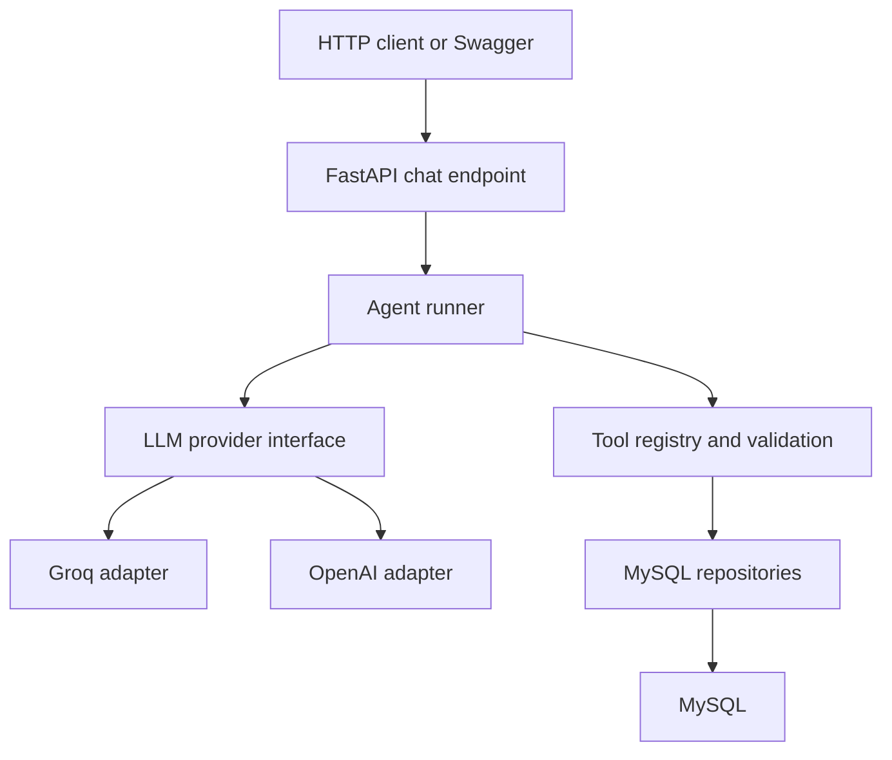

# Communication AI Service

A Python microservice that uses an AI agent to investigate WhatsApp message data through controlled tools.

Built with FastAPI, MySQL, and a provider interface designed for Groq and OpenAI.

## Project Status

This project is a development prototype.

Verified capabilities:

- FastAPI health and chat endpoints.
- Groq model integration.
- Multi-step tool calling.
- Read-only MySQL message summaries.
- WhatsApp status-code lookup.
- Synthetic evaluation of the failure-investigation workflow.

The OpenAI adapter has been added to the implementation instructions, but live OpenAI verification is pending. The current verified configuration uses Groq.

This version uses a fixed development account. It is not ready for public deployment.

## What It Does

Users can ask questions such as:

- “What does status 9 mean in whatsapp_meta?”
- “Show my WhatsApp message summary for August 5, 2023.”
- “Why did my WhatsApp messages fail on August 5, 2023?”

For an investigation, the agent can:

1. Interpret an explicit date or date range.
2. Select a registered tool.
3. Request a message summary.
4. Request a failure breakdown when failed records exist.
5. Explain the returned evidence.

The application validates tool arguments and executes predefined SQL queries. The model does not receive arbitrary SQL execution access.

## Architecture



The provider adapters translate API-specific messages and responses into shared application types.

Database operations run in worker threads to avoid blocking the asynchronous API event loop.

## Technology

- Python 3.12 — development environment
- FastAPI
- Uvicorn
- Pydantic and pydantic-settings
- Groq Python SDK
- OpenAI Python SDK — when installed for the optional adapter
- PyMySQL
- MySQL

## Main Files

| Path | Responsibility |
|---|---|
| `app/main.py` | FastAPI application and provider lifecycle |
| `app/config.py` | Environment configuration |
| `app/db.py` | MySQL connection management |
| `app/api/chat.py` | Chat endpoint |
| `app/api/schemas.py` | Request and response validation |
| `app/api/dependencies.py` | Provider dependency |
| `app/agent/runner.py` | Prompt, tool loop, and execution limits |
| `app/llm/base.py` | Provider contract |
| `app/llm/schemas.py` | Shared message, tool-call, and usage types |
| `app/llm/groq_provider.py` | Groq adapter |
| `app/llm/openai_provider.py` | Optional OpenAI adapter |
| `app/llm/factory.py` | Provider selection |
| `app/tools/registry.py` | Tool definitions and dispatch |
| `app/repositories/messages.py` | Message-summary and failure queries |
| `scripts/check_llm.py` | Basic provider check |
| `scripts/check_mysql.py` | Database connectivity check |
| `scripts/find_tables.py` | Table-location diagnostic |
| `scripts/check_message_summary.py` | Direct repository check |
| `scripts/check_failure_flow.py` | Synthetic agent evaluation |

## Installation

Clone the repository and enter its directory:

```bash
git clone <YOUR_REPOSITORY_URL>
cd <YOUR_REPOSITORY_DIRECTORY>
```

Create and activate a virtual environment:

```bash
python3 -m venv .venv
source .venv/bin/activate
```

Install dependencies:

```bash
python -m pip install -r requirements.txt
```

Create local configuration:

```bash
cp .env.example .env
```

Fill in the required values in `.env`.

## Configuration

```dotenv
APP_NAME="Communication AI Service"
APP_ENV=development

LLM_PROVIDER=groq
LLM_MODEL=openai/gpt-oss-20b

GROQ_API_KEY=
OPENAI_API_KEY=

LLM_TIMEOUT_SECONDS=30
AGENT_MAX_TOOL_CALLS=8

MYSQL_HOST=127.0.0.1
MYSQL_PORT=3306
MYSQL_USER=
MYSQL_PASSWORD=
MYSQL_DATABASE=Main

MYSQL_CAMPAIGN_SCHEMA=Main
MYSQL_WHATSAPP_SCHEMA=login_db

MYSQL_CONNECT_TIMEOUT_SECONDS=10
MYSQL_READ_TIMEOUT_SECONDS=15
MYSQL_SSL_CA=

DEV_ACCOUNT_USERNAME=
```

Use an authorized development account and database credentials with appropriate read permissions.

`MYSQL_SSL_CA` optionally specifies a CA certificate path for verified TLS.

Never commit `.env` or real credentials.

## Database Requirements

This project expects existing application tables. It does not create or seed them.

The current message repository uses:

- `Main.Customers`
- The configured WhatsApp schema’s `whatsapp_meta` table

Required customer fields include:

- `UserId`
- `Username`
- `Active`

Required message fields include:

- `userid`
- `username`
- `created_at`
- `status`
- `error`
- `error_reason`

The development account is resolved through `Main.Customers.Username`.
Message queries require both its user ID and username to match.

The current repository accepts customers with `Active = 0`, following the supplied application schema.

The customer-table location is currently hard-coded as `Main.Customers`.
Campaign schema configuration exists, but campaign-specific queries are not implemented yet.

## Run the Service

```bash
python -m uvicorn app.main:app --reload --port 8000
```

Local endpoints:

- Health: http://127.0.0.1:8000/health/live
- Swagger: http://127.0.0.1:8000/docs

Restart the service after changing provider or account settings in `.env`.

The current API has no authentication. Keep it bound to localhost during development.

## API Usage

### Health

```bash
curl http://127.0.0.1:8000/health/live
```

This endpoint checks application liveness, not database or model-provider availability.

### Chat

```bash
curl -X POST http://127.0.0.1:8000/api/v1/chat \
  -H "Content-Type: application/json" \
  -d '{"message":"Show my WhatsApp message summary for August 5, 2023."}'
```

Response fields:

| Field | Description |
|---|---|
| `answer` | Model-generated explanation |
| `usage.input_tokens` | Input tokens accumulated across model calls |
| `usage.output_tokens` | Output tokens accumulated across model calls |

Each request starts a new conversation. Follow-up messages do not yet retain previous request history.

## Available Tools

### `lookup_whatsapp_status`

Looks up message status definitions from the supplied database schema:

| Code | Meaning |
|---|---|
| 1 | Submitted |
| 2 | Sent |
| 3 | Delivered |
| 4 | Read |
| 9 | Failed |

Unmapped codes, including `0`, remain unknown.

### `get_whatsapp_message_summary`

Returns message counts by current status for the configured account and date range.

### `get_whatsapp_failure_breakdown`

Returns:

- Total records currently marked failed (`status = 9`).
- Up to ten error-code and error-reason groups.
- Counts for those groups.

Recorded errors are evidence, not independently verified root causes.

## Date and Status Semantics

- Start date is inclusive.
- End date is exclusive.
- Maximum query range is 31 days.
- A single-day request uses that date and the following date.
- Queries filter by stored `created_at` values.
- The storage timezone has not yet been verified.
- Status counts describe current record states, not historical status events.
- A read record is not additionally counted as delivered.
- Zero matches means no records matched the filters.
- Database failures must not be interpreted as zero records.

Relative dates such as “today” currently require clarification.

## Verification

Check the configured provider:

```bash
python -m scripts.check_llm
```

Check MySQL connectivity:

```bash
python -m scripts.check_mysql
```

Check message counts directly:

```bash
python -m scripts.check_message_summary \
  --start 2023-08-05 \
  --end 2023-08-06
```

Choose dates where the configured account has records.

Run the synthetic failure investigation:

```bash
python -m scripts.check_failure_flow
```

This evaluation uses real model calls with synthetic tool results.
It does not query or modify customer records.

The fixture contains:

- 10 total messages.
- 7 read messages.
- 3 failed messages.
- 2 failures with a synthetic timeout reason.
- 1 failure with missing error details.

The automatic check verifies:

1. Summary tool followed by failure-breakdown tool.
2. Correct date arguments.

Review the final answer separately for factual accuracy and unsupported causal claims. One successful run does not establish reliability across all inputs.

## Provider Switching

Verified Groq configuration:

```dotenv
LLM_PROVIDER=groq
LLM_MODEL=openai/gpt-oss-20b
```

OpenAI configuration, after installing its adapter and SDK:

```dotenv
LLM_PROVIDER=openai
LLM_MODEL=gpt-4.1-mini
OPENAI_API_KEY=<YOUR_LOCAL_API_KEY>
```

The selected model must be accessible to the API account and compatible with the adapter.

Run both provider checks after switching:

```bash
python -m scripts.check_llm
python -m scripts.check_failure_flow
```

Live OpenAI verification is currently pending.

## Current Limitations

- Fixed development account; no authenticated user-to-account mapping.
- No persistent conversation memory.
- No campaign-specific investigation or campaign comparison.
- No direct WhatsApp, SMS, or Telegram channel integration.
- No database connection pool.
- No Docker packaging.
- No unified provider-error classification or controlled retry policy.
- Limited evaluation coverage.
- The API’s overall deadline does not forcibly cancel a database query already running in a worker thread.
- Query performance and indexes have not been validated for production scale.

## Planned Work

- Verify the OpenAI adapter.
- Add persistent conversation state.
- Integrate application authentication and account permissions.
- Verify campaign-to-message relationships.
- Add campaign investigations and comparisons.
- Add pooling, observability, and broader evaluations.
- Package the service with Docker.
- Integrate with the company application or messaging channels.